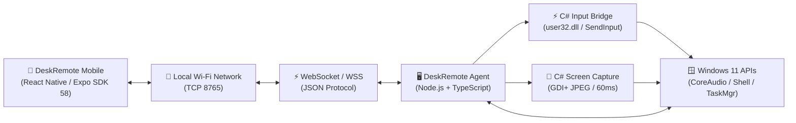

# 📱 DeskRemote — Wireless Desktop Remote Control System

[](https://github.com)
[](https://expo.dev)
[](https://reactnative.dev)
[](https://nodejs.org)
[](https://microsoft.com)
[](https://developer.mozilla.org/en-US/docs/Web/API/WebSocket)
[-success)](https://github.com)
[](LICENSE)

> Turn your smartphone into a wireless touchpad, keyboard, media remote, file manager, and system controller for Windows 11 over local Wi-Fi.

---

## ⚡ Highlights

- 🏎️ **Zero-Lag Native Touchpad**: Sub-millisecond cursor movement powered by a background C# native input engine (`deskremote-input.exe`).
- ⌨️ **Native Smartphone Keyboard & Shortcuts**: Real-time typing and 1-tap shortcuts (`Ctrl+C`, `Ctrl+V`, `Alt+Tab`, `Win+D`, etc.).
- 🔊 **Audio & Media Remote**: Windows CoreAudio master volume slider, mute toggle, and media session playback controls.
- 🪟 **Active Window & App Launcher**: Focus, minimize, maximize, or close active windows; launch allowlisted apps directly from phone.
- 📁 **Restricted File Explorer**: Browse user directories (`Desktop`, `Downloads`, `Documents`), upload, download, rename, and delete files with path traversal protection.
- 📸 **Low-Latency Screenshot Streamer**: Native JPEG screen capture in under 60ms with optional live monitoring mode.
- 📊 **Real-Time Performance Dashboard**: Live CPU %, RAM usage, disk stats, network interfaces, and top resource-heavy processes.
- 🔒 **PIN Authentication & Local Wi-Fi**: QR code pairing, 6-digit persistent PIN, rate limiting, and zero third-party cloud dependencies.

---

## 🏗️ Architecture Overview



- **Shared Protocol (`/shared`)**: Strict TypeScript message contracts, payload schemas, and event definitions shared between client and server.
- **Desktop Agent (`/desktop-agent`)**: Lightweight Node.js server with compiled C# native engines (`deskremote-input.exe`, `deskremote-screen.exe`) executing low-level Windows APIs.
- **Mobile Application (`/mobile`)**: Sleek dark-mode React Native app with Expo Router, smooth haptic gesture touchpad, and responsive UI.

---

## 📦 Features & Modules

| Module | Features |
|---|---|
| **Device Pairing** | QR code pairing, persistent 6-digit PIN, rolling 30-min token sessions, auto-reconnect |
| **Touchpad & Mouse** | Relative cursor movement, tap-to-click, double-tap, 2-finger right-click, 2-finger scroll, drag lock, sensitivity slider |
| **Keyboard & Keys** | Native mobile keyboard input, Enter, Backspace, Tab, Esc, Ctrl/Alt/Win modifiers, custom shortcuts |
| **Audio & Media** | CoreAudio volume slider (0–100%), mute/unmute, Play/Pause, Next Track, Previous Track |
| **Window Management** | List active windows, switch/focus, minimize, maximize/restore, close window |
| **App Management** | Launch apps (Edge, Notepad, Calc, Explorer, Task Manager, Settings), terminate processes |
| **Power Management** | Lock desktop (`LockWorkStation`), sleep, safe restart & shutdown with 30s token confirmation |
| **File Explorer** | Sandboxed navigation (`Desktop`, `Downloads`, `Documents`, etc.), folder creation, download, rename, delete |
| **Screenshots** | Fast full-screen capture (<60ms), live preview stream mode (2.5s interval), AMSI-safe |
| **System Monitor** | Live CPU usage %, memory bar, physical disk space, active network adapters, top 15 processes |

---

## 🚀 Quick Start Guide

### Prerequisites
- **Windows 11 PC** with [Node.js v18+](https://nodejs.org/) installed
- **Smartphone** (iOS or Android) with [Expo Go](https://expo.dev/go) installed
- Both devices connected to the **same local Wi-Fi network**

---

### Step 1: Start the Desktop Agent

Open PowerShell on your Windows 11 PC:

```powershell
cd c:\projects\bedrot\desktop-agent

# Build and start the agent (or double-click start-agent.bat)
npm start
```

The agent will display your LAN IP address, Security PIN, and an ASCII QR code:

```text
=============================================
  DeskRemote Desktop Agent v1.0.0
=============================================
  📡 Server (LAN):     ws://192.168.1.22:8765
  🔑 Security PIN:     607129
  🖥️  Host:            DESKTOP-PC
  💻 OS:              Windows 10.0.26200
  🔒 Security:        Local Network (Standard)
=============================================
  👉 In mobile app, enter IP: 192.168.1.22 and PIN: 607129
=============================================

  📲 Scan to Pair:
  [QR CODE]
  Waiting for connections...
```

> [!TIP]
> If your phone cannot connect, run `desktop-agent\add-firewall-rule.bat` as Administrator to ensure Windows Defender Firewall allows inbound TCP traffic on port 8765.

---

### Step 2: Start the Mobile Application

In another terminal:

```powershell
cd c:\projects\bedrot\mobile
npx expo start
```

1. Open **Expo Go** on your phone (or camera app on iOS).
2. Scan the Metro QR code.
3. Tap **Connect** on the DeskRemote home screen.
4. Verify the **IP Address** and **PIN** shown on your desktop agent terminal.
5. Tap **Connect** — the status badge will turn green (`Connected`)!

---

### Step 3: Optional Windows Startup Service

To run DeskRemote Agent automatically in the background every time Windows boots:

```powershell
cd c:\projects\bedrot\desktop-agent\scripts
powershell -ExecutionPolicy Bypass -File install-startup.ps1
```

To remove from startup:
```powershell
powershell -ExecutionPolicy Bypass -File uninstall-startup.ps1
```

---

## 🛡️ Security Model

- **Local Network Only**: Binds strictly to your private LAN (`0.0.0.0:8765`); never exposed to public internet.
- **PIN Verification**: Every client must authenticate with the server's 6-digit PIN before any command is executed.
- **Session Expiration**: Authentication tokens automatically expire after 30 minutes of inactivity.
- **Path Traversal Sandboxing**: File operations are strictly restricted to user folders (`Desktop`, `Downloads`, `Documents`, `Pictures`, `Music`, `Videos`). Path traversal attacks (`../`) are blocked.
- **Rate Limiting**: Commands are rate-limited to 100 requests/sec per client.
- **Two-Step Destructive Action Confirmation**: Restart and shutdown actions require an explicit token confirmation handshake.

---

## 🧪 Automated Testing

DeskRemote includes a comprehensive 29-test end-to-end integration suite verifying all modules:

```powershell
cd c:\projects\bedrot\desktop-agent
node dist/test-all-modules.js
```

```text
═══════════════════════════════════════════════════════
  DeskRemote Full Integration & Security Test Suite     
═══════════════════════════════════════════════════════
  ✅ PASS: 1.01 WebSocket connection
  ✅ PASS: 1.02 Keepalive pong received
  ✅ PASS: 1.03 Unauthenticated command rejected
  ✅ PASS: 1.04 Invalid PIN rejected
  ✅ PASS: 1.05 Valid PIN authenticated
  ✅ PASS: 1.06 Device info received
  ✅ PASS: 2.01 Mouse move relative
  ✅ PASS: 2.02 Mouse click (left)
  ✅ PASS: 2.03 Mouse click (right)
  ✅ PASS: 2.04 Mouse scroll
  ✅ PASS: 2.05 Mouse drag (start/move/end)
  ✅ PASS: 3.01 Keyboard text typing
  ✅ PASS: 3.02 Keyboard special key
  ✅ PASS: 3.03 Keyboard shortcut
  ✅ PASS: 4.01 Audio getState
  ✅ PASS: 4.02 Audio setVolume
  ✅ PASS: 4.03 Audio mute toggle
  ✅ PASS: 5.01 Media playPause
  ✅ PASS: 5.02 Media next
  ✅ PASS: 5.03 Media previous
  ✅ PASS: 6.01 Windows list active
  ✅ PASS: 6.02 Applications list
  ✅ PASS: 6.03 App launch rejected for unallowed app
  ✅ PASS: 7.01 Power state query
  ✅ PASS: 7.02 Dangerous restart requires confirmation
  ✅ PASS: 8.01 File list approved directory
  ✅ PASS: 8.02 File path traversal / forbidden path blocked
  ✅ PASS: 9.01 Screenshot capture
  ✅ PASS: 9.02 System monitor full report
═══════════════════════════════════════════════════════
  Score: 29 / 29 tests passed (100%)
```

---

## 📂 Repository Structure

```text
bedrot/
├── shared/                     # Shared TypeScript protocol library
│   └── protocol/               # Messages, event definitions, and validation schemas
├── desktop-agent/              # Windows 11 Node.js background agent
│   ├── bin/                    # Precompiled native C# helper executables
│   │   ├── deskremote-input.exe   # High-speed cursor and keyboard automation
│   │   └── deskremote-screen.exe  # Sub-60ms native screenshot capture
│   ├── native/                 # C# source code for native input and screen capture
│   ├── scripts/                # Startup installer and firewall scripts
│   ├── src/                    # Controllers, middleware, security, and WebSocket server
│   ├── add-firewall-rule.bat   # 1-click Windows Defender Firewall configuration
│   └── start-agent.bat         # 1-click agent launcher
└── mobile/                     # React Native Expo mobile application
    ├── app/                    # Expo Router screens ((tabs), connect, _layout)
    └── src/                    # Components, hooks, services, and theme definitions
```

---

## 📄 License

This project is licensed under the MIT License — see the [LICENSE](LICENSE) file for details.
